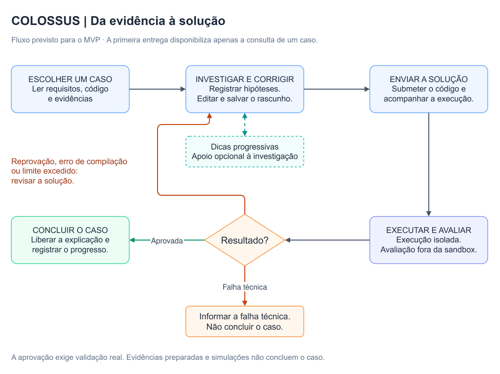

# Especificação do Projeto

Status: Vigente

## O que é o Colossus

O Colossus será uma plataforma web para aprender e praticar debugging por meio de casos investigativos. Cada caso começa com uma pergunta concreta: **por que este programa está se comportando de forma diferente do esperado?**

O participante recebe requisitos, código com defeitos e evidências. A partir deles, investiga a causa, registra hipóteses e desenvolve uma correção. Na experiência completa, poderá executar sua solução em ambiente isolado, consultar os resultados e concluir o caso após uma validação aprovada.

A proposta e as tecnologias do planejamento de referência permanecem. O trabalho será organizado em entregas menores; esta especificação delimita o produto, sem impor um cronograma de implementação.

## Quem utiliza

| Papel | O que precisa fazer |
|---|---|
| **Participante** — estudante, iniciante ou desenvolvedor em formação | Encontrar casos adequados ao seu conhecimento, investigar bugs com apoio de evidências e dicas, testar correções e acompanhar seu progresso. |
| **Autor ou administrador de casos** — inicialmente, o desenvolvedor do projeto | Preparar e revisar enunciados, código, evidências, dicas, testes e explicações; manter a coerência dos casos e proteger o conteúdo reservado. |

O papel de autor não exige uma interface administrativa na primeira entrega.

## Da evidência à solução

O fluxo abaixo representa a experiência prevista para o MVP. As dicas são opcionais; uma solução que não passa pela validação retorna à investigação. Falhas de infraestrutura são informadas separadamente e não concluem o caso.

[Fonte editável do diagrama (.drawio)](assets/fluxo-investigacao.drawio)

## O que entra em cada entrega

**Primeira entrega:** consultar um caso por uma API local.

**MVP completo:** realizar uma investigação de ponta a ponta, com identidade, persistência, interface e validação real.

| Capacidade | Primeira entrega | MVP completo |
|---|---|---|
| Consulta do caso e de suas evidências públicas | Um caso, por HTTP/JSON | Consulta pela interface |
| Catálogo de casos | Não incluído | Disponível para navegação |
| Investigação, hipóteses e rascunhos | Não incluídos | Salvos e retomados pelo participante |
| Dicas progressivas | Sem liberação interativa | Liberadas por solicitação |
| Interface web | Não incluída | Leitura, edição e consulta de resultados |
| Identidade e controle de acesso | Sem autenticação; uso local | Dados individuais associados ao usuário e acesso controlado |
| Armazenamento | Dados didáticos em memória | Persistência em PostgreSQL |
| Submissão, execução e validação | Indisponíveis | Execução isolada e resultados reais |
| Conclusão, explicação e progresso | Indisponíveis | Conclusão após aprovação, explicação liberada e histórico consultável |

**Evolução prevista após o MVP:** pontuação, níveis e conquistas. As regras serão definidas antes da implementação.

Publicar para terceiros exige também verificar os controles de segurança e operação. A conclusão funcional do MVP, por si só, não encerra essa preparação.

## Primeira entrega: O desconto fantasma

O programa aplica descontos a clientes que não deveriam recebê-los. O caso convida o participante a investigar a condição responsável por esse comportamento.

A API disponibilizará o enunciado, os requisitos, o código defeituoso e as evidências públicas, armazenados em memória. **Os resultados apresentados são evidências preparadas pelo autor; a API ainda não executará o código.**

### Como verificar se a entrega está pronta

- [ ] A aplicação inicia localmente sem banco de dados.
- [ ] A consulta HTTP retorna JSON com identificação, título, enunciado, requisitos, código inicial e evidências públicas.
- [ ] O conteúdo distingue o comportamento esperado do observado e permite compreender o problema.
- [ ] A resposta não expõe a solução explicada nem testes reservados.
- [ ] A consulta foi verificada e seu resultado foi registrado em Checkpoints e Evidências.

## Regras que preservam a experiência

- **Aprovação por comportamento:** a solução deve atender aos requisitos e testes obrigatórios. Implementações diferentes podem resolver o mesmo caso.
- **Investigação com informações suficientes:** testes reservados verificam os requisitos apresentados; não introduzem regras secretas.
- **Conclusão com evidência real:** resultados preparados e simulações não aprovam submissões nem concluem casos.
- **Execução separada da API:** código submetido não é executado na JVM da aplicação. Exige isolamento e limites de recursos, com avaliação fora do ambiente que executa o código.
- **Explicação após aprovação:** a liberação faz parte do fluxo de conclusão do caso e é controlada pelo backend.

Os comportamentos detalhados ficam em Requisitos Funcionais. As condições de qualidade e segurança ficam em Requisitos Não Funcionais, com os detalhes técnicos nos documentos de arquitetura.

## Base técnica prevista

| Responsabilidade | Diretriz |
|---|---|
| Backend e API | Java, Spring Boot e Maven; funcionalidades principais em uma aplicação monolítica. |
| Persistência | PostgreSQL, com evolução do banco por migrations do Flyway. |
| Interface | HTML, CSS e JavaScript. |
| Autenticação e autorização | Spring Security. |
| Execução de soluções | Componente separado por uma fronteira de segurança; ambiente definitivo ainda em avaliação. |

Java será a linguagem dos primeiros casos. A tabela resume a base técnica; dependências instaladas e tecnologias previstas não representam funcionalidades já implementadas.

## Limites do MVP

Ficam fora do MVP:

- Outras linguagens, upload de projetos completos, arquivos JAR e dependências arbitrárias.
- Terminal de shell remoto.
- Multiplayer, comunidade, marketplace e recursos de inteligência artificial no produto.
- Ranking público e gamificação avançada.

Essas exclusões delimitam o MVP; não constituem compromisso de implementação futura.

## Decisões ainda abertas

- **Conteúdo e experiência:** próximos casos, organização do catálogo, telas e detalhes dos fluxos.
- **Gamificação:** regras de pontuação e progressão.
- **Execução:** limites de submissão e recursos, escolha definitiva e validação do ambiente de isolamento.
- **Publicação:** condições de segurança e operação para disponibilizar o produto a terceiros.

## Situação registrada

A estrutura inicial do Spring Boot foi criada e sua inicialização local foi verificada. A configuração automática do banco e o Flyway estão temporariamente desativados.

A consulta do primeiro caso ainda será implementada. O status **Vigente** indica que esta especificação orienta o projeto; não indica que as funcionalidades já estão prontas.